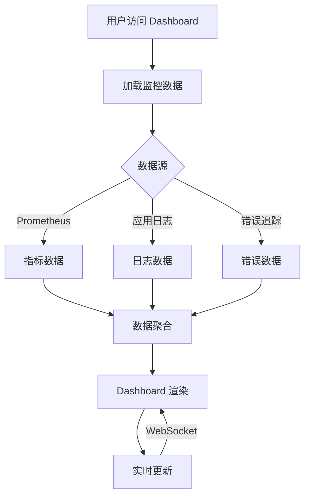

# Agent Toolkit 监控 Dashboard 产品需求文档

## 1. 产品概述

Agent Toolkit 智能监控 Dashboard - 一款专为多代理工具编排系统设计的高性能可视化监控平台。系统提供实时指标追踪、错误分析、性能监控、安全态势感知等功能，帮助运维团队快速洞察系统健康状态，提升故障排查效率。

**核心价值**：将复杂的系统指标转化为直观易懂的视觉呈现，让运维人员从数据海洋中解放出来，专注于问题解决。

## 2. 核心功能

### 2.1 用户角色

| 角色 | 权限范围 | 核心功能 |
|------|---------|---------|
| 运维工程师 | 完整访问 | 系统监控、告警管理、故障诊断 |
| 开发人员 | 只读访问 | 性能分析、错误追踪、API 调用分析 |
| 管理员 | 完整访问 + 配置 | 系统配置、用户管理、策略设置 |

### 2.2 功能模块

1. **实时监控面板** - 系统概览、核心指标、活跃请求
2. **性能分析中心** - 响应时间、吞吐量、资源利用率
3. **错误追踪系统** - 错误分类、堆栈追踪、错误趋势
4. **安全监控台** - 攻击检测、速率限制、异常访问
5. **工具链可视化** - DAG 可视化、执行流程追踪

### 2.3 页面详情

| 页面名称 | 模块名称 | 功能描述 |
|---------|---------|---------|
| 监控面板 | 系统概览卡片 | 展示系统总请求数、错误率、平均响应时间 |
| 监控面板 | 实时活跃请求 | 实时更新的活跃请求数量和时间序列图 |
| 监控面板 | 模块状态卡片 | Registry/Adapter/Orchestrator/Runtime/Observability 五个模块的健康状态 |
| 性能分析 | 响应时间趋势 | 过去 24 小时响应时间折线图（P50/P95/P99） |
| 性能分析 | 吞吐量仪表盘 | QPS、TPS 实时仪表盘 |
| 性能分析 | 慢请求列表 | Top 10 最慢请求排名及详情 |
| 错误追踪 | 错误分布饼图 | 按错误类型分类的错误分布 |
| 错误追踪 | 错误时间线 | 错误发生的时间线和频率统计 |
| 错误追踪 | 错误详情面板 | 点击查看堆栈信息、请求上下文 |
| 安全监控 | 速率限制统计 | 各 IP 的请求频率和限制触发情况 |
| 安全监控 | 安全事件日志 | 异常访问、SQL注入、XSS 尝试等安全事件 |

## 3. 核心流程



## 4. 用户界面设计

### 4.1 设计风格

**风格定位**：科技感 + 极简主义 + 数据可视化美学

- **主色调**：深空灰 `#1a1a2e` 背景 + 霓虹蓝 `#00d9ff` 主色
- **辅助色**：
  - 成功绿 `#00ff88`
  - 警告橙 `#ff9500`
  - 错误红 `#ff3366`
- **强调色**：渐变紫 `#667eea` → `#764ba2`

**字体选择**：
- 标题：Orbitron（科技感强）
- 正文：Rajdhani（现代简洁）
- 数据：JetBrains Mono（等宽，适合数字）

**布局风格**：
- 网格布局，卡片式设计
- 深色主题，减少视觉疲劳
- 响应式设计，适配桌面/平板

**动效设计**：
- 数据加载：骨架屏 + 渐入动画
- 数字变化：数字滚动效果
- 卡片悬停：轻微上浮 + 发光边框
- 图表绘制：路径动画 + 数据点弹跳

### 4.2 页面设计概览

#### 首页 - 监控面板

```
┌─────────────────────────────────────────────────────────┐
│  🚀 Agent Toolkit Monitor            [🔔] [👤 Admin]   │
├─────────────────────────────────────────────────────────┤
│  ┌─────────────┐ ┌─────────────┐ ┌─────────────┐      │
│  │ 总请求数     │ │ 错误率       │ │ 平均响应时间  │      │
│  │ 1,234,567  │ │ 0.12%      │ │ 23ms       │      │
│  └─────────────┘ └─────────────┘ └─────────────┘      │
│                                                         │
│  ┌───────────────────────────────────────────────────┐ │
│  │              实时活跃请求 (折线图)                  │ │
│  │                                                   │ │
│  └───────────────────────────────────────────────────┘ │
│                                                         │
│  ┌─────────┐ ┌─────────┐ ┌─────────┐ ┌─────────┐     │
│  │Registry │ │Adapter  │ │Orchestr │ │Runtime  │     │
│  │  🟢健康  │ │  🟢健康  │ │  🟢健康  │ │  🟢健康  │     │
│  └─────────┘ └─────────┘ └─────────┘ └─────────┘     │
└─────────────────────────────────────────────────────────┘
```

### 4.3 响应式设计

- **桌面端 (≥1200px)**：4 列网格，完整侧边栏
- **平板端 (768-1199px)**：2 列网格，折叠侧边栏
- **移动端 (<768px)**：单列堆叠，汉堡菜单

## 5. 技术实现

### 5.1 前端技术栈

- **框架**：原生 HTML5 + CSS3 + JavaScript ES6+
- **图表库**：Chart.js 4.x（轻量级、高性能）
- **图标**：Lucide Icons（现代化 SVG 图标）
- **动画**：CSS3 Transitions + requestAnimationFrame
- **字体**：Google Fonts（Orbitron, Rajdhani, JetBrains Mono）

### 5.2 数据源

- **Prometheus Metrics**：`/metrics` 端点
- **应用 API**：`/api/v1/...` REST API
- **WebSocket**：`ws://.../ws` 实时推送（可选）

### 5.3 集成方式

Dashboard 将作为 FastAPI 应用的静态文件服务，直接嵌入到现有系统中，无需独立部署。
