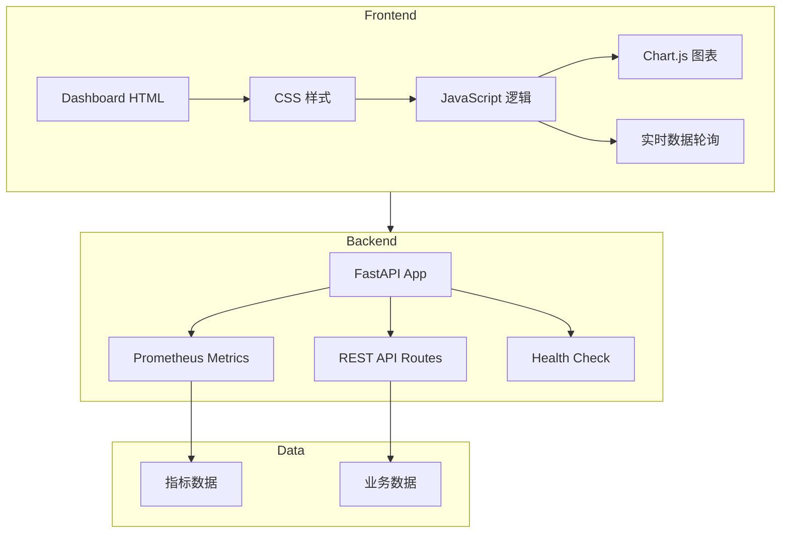

# Agent Toolkit 监控 Dashboard 技术架构文档

## 1. 架构设计



## 2. 技术选型

### 前端技术
- **HTML5 + CSS3 + JavaScript ES6+**
- **Chart.js 4.x**：高性能图表库
- **Lucide Icons**：SVG 图标库
- **Google Fonts**：Orbitron, Rajdhani, JetBrains Mono

### 后端技术
- **FastAPI**：现有框架，直接集成
- **Prometheus Client**：指标收集
- **Pydantic**：数据验证

### 数据源
- **Prometheus Metrics Endpoint**：`/metrics`
- **Health Endpoint**：`/health`
- **Stats Endpoint**：`/api/v1/tools/stats`

## 3. 路由定义

| 路由 | 用途 | 返回数据 |
|------|------|---------|
| `/` | Dashboard 首页 | HTML 页面 |
| `/metrics` | Prometheus 指标 | Prometheus 格式指标 |
| `/health` | 健康检查 | 健康状态 JSON |
| `/api/v1/tools/stats` | 工具统计 | 统计数据 |

## 4. API 定义

### 4.1 健康检查接口

```json
GET /health

Response:
{
  "status": "healthy",
  "timestamp": "2026-01-01T00:00:00Z",
  "version": "0.1.0"
}
```

### 4.2 指标接口

```
GET /metrics

Response (Prometheus format):
# HELP agent_toolkit_requests_total Total requests
# TYPE agent_toolkit_requests_total counter
agent_toolkit_requests_total{method="GET",endpoint="/health",status_code="200"} 1234
```

## 5. 部署架构

Dashboard 将作为 FastAPI 的静态文件路由集成，直接从 `/dashboard` 路径访问，无需独立部署。
